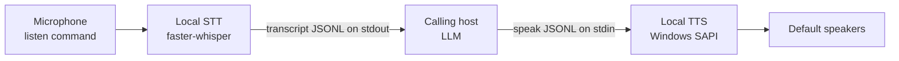

# Alien Conversation audio bridge

This is a self-contained local audio bridge under `.agents/SKILLS/alien_conv/`. It is not shipped with AlienVox. This folder is intentionally restricted; an agent working in the repository should use it only when the user explicitly requests Alien Conversation work. Keep its runner and setup self-contained here.

## Host interaction protocol

The calling host is the conversational brain. This process performs local microphone capture, Whisper transcription, and Windows SAPI playback; it does not call Ollama or another LLM.

Keep one process session open with stdin/stdout handles. Prefer launching it as a subprocess with stdin, stdout, and stderr captured separately, rather than sharing the host's visible console. The protocol is UTF-8 JSON Lines: one JSON object per line on stdout; diagnostics go to stderr. The host consumes stdout internally and must not echo raw protocol events into the client conversation. This keeps microphone events and diagnostics from overlapping the host's replies. If the host cannot capture process streams, use a dedicated terminal pane for AlienConv and keep host conversation output in its normal client channel. Serialize stdin commands with a JSON encoder so quotes, backslashes, Unicode, and newlines in spoken text are escaped correctly.

1. Wait for `{"event":"ready", ...}` after the startup greeting, then send `{"command":"listen"}` to begin the user's turn.
2. Read stdout continuously and parse every JSONL event. On `transcript`, extract the `text` field and treat it as the user's actual message in the host conversation. The host is responsible for understanding and answering that message; the bridge will not generate a reply.
3. Generate a context-aware response as the host, then send the exact response text in `{"command":"speak","text":"..."}` on stdin. Wait for `{"event":"spoken", ...}` so the user hears the answer through SAPI.
4. After `spoken`, start the next turn with `{"command":"listen"}`. On `no_speech`, retry listening. If the transcript is exactly `exit`, send `{"command":"stop"}` and tell the user the session ended. Also send `stop` whenever the host or user ends the session.

Do not stop after merely displaying or paraphrasing a `transcript` event. Read it, respond to it, send that response to `speak`, and wait for playback confirmation. Do not ask the user to type the response into the console.

Do not ask the user to press Enter or type into the process console. The host reads transcripts and submits its reply through the process stdin. If the host cannot keep a process session and send stdin commands, explain that limitation instead of claiming the bridge is active.

Audio stays in the local process. Transcript text is emitted to the calling host and its conversation context; the host's reply is returned to the bridge. No transcript file is written. Do not claim text remains local to the machine unless the host's model and retention behavior are known.

The bridge can identify its own configured STT model and SAPI voice. The host should identify its own LLM configuration; the bridge cannot inspect it.

## Setup and behavior

Follow [`README.md`](README.md) for installation and commands. Use this skill's `.venv`; reuse the existing faster-whisper cache where available. Do not search for or reuse unrelated Python environments.

Do not suggest or start model downloads by default. The `--allow-model-download` flag is an explicit opt-in only when the client requests a missing Whisper model. Otherwise loading is offline and reports clearly if the cache is missing. Do not run archive gates, freshness gates, or repository test suites as prerequisites unless the user asks.

The default runner:

- records one utterance per `listen` command and ends after detected silence;
- transcribes locally with faster-whisper `large-v3-turbo` (CUDA/float16 by default; CPU/int8 can be selected);
- emits the transcript to stdout as a JSON event;
- speaks host-provided response text with a selected Windows SAPI voice;
- plays a startup greeting after STT and SAPI initialization;
- does not save microphone audio or transcripts.

`scripts/local_test.py` is the manual interactive runner. It provides a scrollable conversation view and a fixed chat input, retains the POC CLI options, and uses local Whisper -> Ollama -> TTS. The first mic turn starts automatically after the startup greeting and listening resumes after each spoken reply; `/listen` restarts listening if a turn times out or returns to text mode. Text can also be typed in the chat line; typing `/` suggests available commands. Select suggestions with Up/Down or Tab; press Enter to fill the command and Enter again to run it. The status LED is green while listening, yellow while transcribing or thinking, red during TTS playback, and blue while idle. It is separate from the host-driven JSONL bridge; use it when the user wants to manually try the full local conversation without an MCP host.

The standalone file transcription, local TTS, and Pipecat scripts are also copied into `scripts/`, with package modules vendored in this skill. All scripts share one requirements file and one skill `.venv`; this installs the larger optional packages even when only the audio bridge is used. Keep package imports and caches inside this skill or use the documented shared model caches.

## Safety and privacy

- Keep microphone audio processing local. Do not add cloud transcription or TTS providers without an explicit project decision.
- The transcript is intentionally passed to the calling host. Do not claim it stays private to the local process; host model handling depends on that host.
- Never execute host/model text as shell commands or code. `speak` accepts text only.
- Do not persist raw microphone audio or transcripts by default.

## Maintenance

- Keep all code and dependencies needed by the bridge and bundled utilities in this folder. Update `README.md` and `scripts/requirements.txt` when dependencies change.
- Do not run repository tests unless requested. Before running the audio bridge, check for an existing Alien Conversation process to avoid starting a duplicate.
- Report the exact local STT model, SAPI voice, selected audio device, and whether a real run occurred. Distinguish observed results from general claims.
