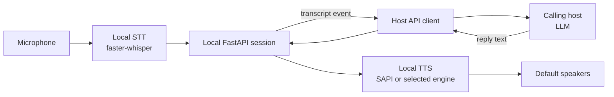

# Alien Conversation audio bridge

This is a self-contained local audio bridge under `.agents/SKILLS/alien_conv/`. It is not shipped with AlienVox. This folder is intentionally restricted; an agent working in the repository should use it only when the user explicitly requests Alien Conversation work. Keep its runner and setup self-contained here.

## Host interaction modes

The calling host is the conversational brain. The local console captures microphone audio, transcribes with faster-whisper, and speaks host-provided replies with local TTS. It does not call Ollama in host-driven mode. Choose one of these modes:

1. **Start a visible console:** run `scripts/local_test.py --mode api-server --api-host 127.0.0.1 --api-port 8765` in its own visible terminal. This starts the interactive console and its embedded FastAPI service; copy the URL from the console title.
2. **Connect to a running session:** launch `scripts/api_client.py --mode connect --url http://127.0.0.1:8765` as a persistent subprocess. Use the URL and port shown by the running console and supplied by the user.

The API client is the host-facing stdin/stdout JSONL adapter. Stdout contains one JSON object per line; diagnostics go to stderr. Consume events internally and do not echo raw protocol JSON to the user. The console displays transcripts, host replies, and activity state. The host must also relay status to the user in the normal conversation channel because the user may not see the console.

Events include `ready`, `listening`, `transcribing`, `transcript` (with `text`), `no_speech`, `speaking`, `spoken`, `error`, `disconnected`, and `stopped`. After `transcript`, treat the text as the user's actual message, acknowledge it briefly, and answer in context. While preparing the reply, send `{"command":"status","phase":"thinking","message":"..."}`. Then send `{"command":"speak","text":"..."}` with the exact answer. `spoken` confirms TTS finished; listening resumes automatically. On `no_speech`, tell the user briefly and wait for the next `listening` event. If the transcript is exactly `exit`, send `{"command":"stop"}` and tell the user the session ended. Also send `stop` whenever the host or user ends the session.

The server API exposes `GET /v1/health`, long-poll `GET /v1/events?timeout=15`, and `POST /v1/reply`, `/v1/status`, `/v1/listen`, `/v1/stop`. Prefer the bundled API client over direct HTTP calls. It emits events as JSONL and accepts `status`, `speak`, `listen`, and `stop` commands. Serialize command lines with a JSON encoder. For non-loopback binding, configure `--api-token`; the client sends it as a Bearer token. Keep the server on localhost unless remote access is explicitly needed.
`api_client.py` does not generate replies. The host must consume its transcript events and use its own conversational model, then post the answer back as a `speak` command.

## Relay progress to the user

The user cannot see the bridge's process console or its JSONL status events. Relay the important observed states in the normal conversation channel, briefly and as they happen:

- On `ready`, tell the user Alien Conversation is ready; wait for the `listening` event before saying it is listening.
- On `listening`, say that it is listening and the user can speak.
- On `transcript`, acknowledge that speech was received and that you are preparing a reply; then understand and answer the transcript.
- On `speaking`, tell the user the reply is being spoken.
- After `spoken`, send the next `listen` command. Let the following `listening` event confirm that listening resumed.
- On `no_speech`, say briefly that no speech was detected, then retry as directed above.
- On `error` or process failure, report the observed error and whether the bridge is still running. Never claim it is listening, speaking, or ready unless the corresponding event confirms that state.

Do not show raw JSONL or routine diagnostic output. Use one short progress update per state change, and avoid repeating a status that was just relayed.

Do not ask the user to press Enter or type into the process console. The host reads transcripts and submits its reply through the process stdin. If the host cannot keep a process session and send stdin commands, explain that limitation instead of claiming the bridge is active.

Audio stays in the local process. Transcript text is emitted to the calling host and its conversation context; the host's reply is returned to the bridge. No transcript file is written. Do not claim text remains local to the machine unless the host's model and retention behavior are known.

The bridge can identify its own configured STT model and SAPI voice. The host should identify its own LLM configuration; the bridge cannot inspect it.

## Setup and behavior

Follow [`README.md`](README.md) for installation and commands. Use this skill's `.venv`; reuse the existing faster-whisper cache where available. Do not search for or reuse unrelated Python environments.

Do not suggest or start model downloads by default. The `--allow-model-download` flag is an explicit opt-in only when the client requests a missing Whisper model. Otherwise loading is offline and reports clearly if the cache is missing. Do not run archive gates, freshness gates, or repository test suites as prerequisites unless the user asks.

The default runner:

- records one utterance per `listen` command and ends after detected silence;
- transcribes locally with faster-whisper `large-v3-turbo` (CUDA/float16 by default; CPU/int8 can be selected);
- emits the transcript to stdout as a JSON event;
- speaks host-provided response text with a selected Windows SAPI voice;
- plays a startup greeting after STT and SAPI initialization;
- does not save microphone audio or transcripts.

`scripts/local_test.py` is the local interactive console. In `ollama` mode it uses local Whisper -> Ollama -> TTS. In `api-server` mode it uses local Whisper -> host API -> local TTS; `api_client.py` is the host adapter. The first mic turn starts automatically after the startup greeting and listening resumes after each spoken reply; `/listen` restarts listening if a turn times out or returns to text mode. Text can also be typed in the chat line; typing `/` suggests available commands. Select suggestions with Up/Down or Tab; press Enter to fill the command and Enter again to run it. Ctrl+C and `/quit` close the console and API server, stopping capture and releasing a pending host-reply wait. The main status LED is green while listening, yellow while transcribing or thinking, red during TTS playback, and blue while idle. It briefly shows a separate cyan API activity LED when a host `status`, `reply`, or `listen` request is accepted. It is separate from the host-driven JSONL bridge; use it when the user wants to manually try the full local conversation without an MCP host.

The standalone file transcription, local TTS, and Pipecat scripts are also copied into `scripts/`, with package modules vendored in this skill. All scripts share one requirements file and one skill `.venv`; this installs the larger optional packages even when only the audio bridge is used. Keep package imports and caches inside this skill or use the documented shared model caches.

## Safety and privacy

- Keep microphone audio processing local. Do not add cloud transcription or TTS providers without an explicit project decision.
- The transcript is intentionally passed to the calling host. Do not claim it stays private to the local process; host model handling depends on that host.
- Never execute host/model text as shell commands or code. `speak` accepts text only.
- Do not persist raw microphone audio or transcripts by default.

## Maintenance

- Keep all code and dependencies needed by the bridge and bundled utilities in this folder. Update `README.md` and `scripts/requirements.txt` when dependencies change.
- Keep FastAPI request models at module scope in `scripts/local_test.py`; nested models with postponed annotations may be misclassified as query parameters. Direct HTTP writes require JSON bodies (`/v1/status`: `phase`/`message`; `/v1/reply`: `text`).
- Do not run repository tests unless requested. Before running the audio bridge, check for an existing Alien Conversation process to avoid starting a duplicate.
- Report the exact local STT model, SAPI voice, selected audio device, and whether a real run occurred. Distinguish observed results from general claims.
